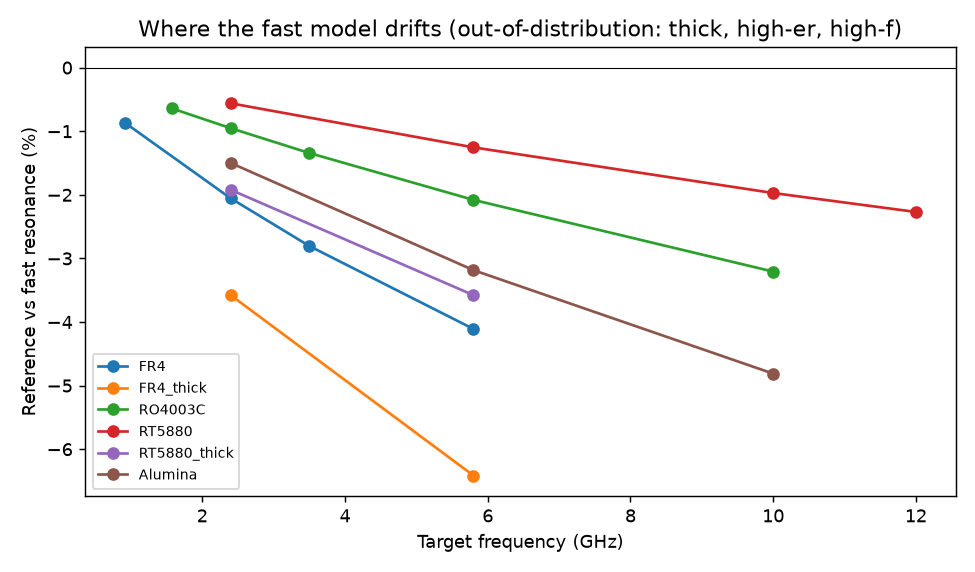
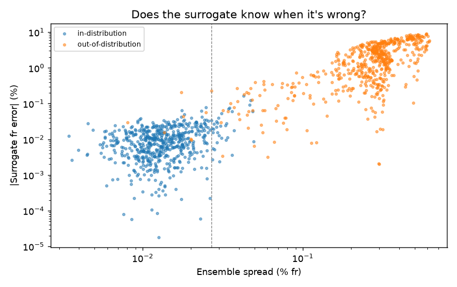
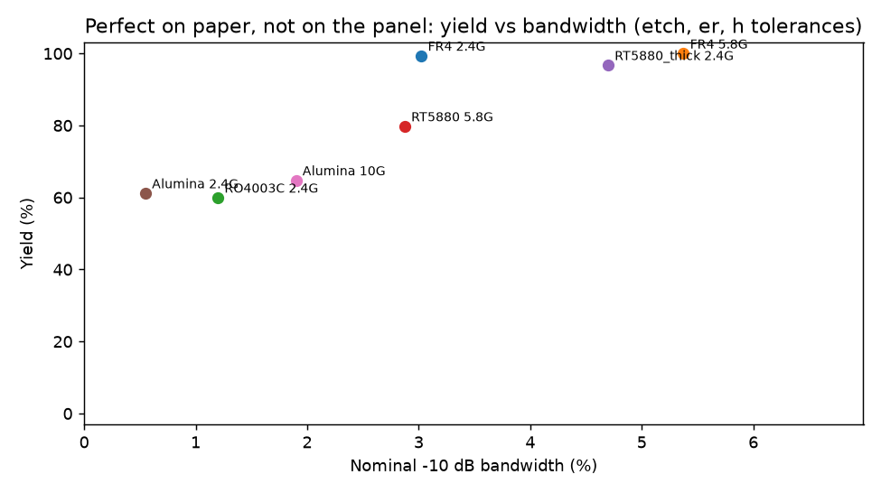

# rf-agent

**Slides:** https://cero753.github.io/rf-agent/ · **Quick tour:** `python demo.py`

An experiment in **agents that design hardware with physics models in the loop**. It covers how much to trust a fast model, when to escalate to an expensive solver, how to keep the agent honest, and what happens once the board is actually built.

The domain is deliberately small (inset-fed rectangular patch antennas). The pieces are the ones a real system needs:

| Piece | File | Question it answers |
|---|---|---|
| Fast physics model + reference model | `rf_tools.py` | How wrong is the quick model, and where? |
| Learned surrogate with uncertainty | `surrogate.py` | Can a learned model beat the hand-written one, and does it know when it's out of its depth? |
| Escalation policy | `surrogate.surrogate_loop_design` | Can we spend fewer expensive solver calls without losing correctness? |
| MCP server | `server.py` | Can any agent (Claude Code, Claude Desktop, agent platforms) use all of this as tools? |
| A real LLM agent arm | `evals/claude_arm.py` | Does Claude use the tools well, stay within budget, and avoid overclaiming? |
| Measurement diagnosis | `diagnose.py` | The board came back off-frequency. Why, how sure are we, and what do we change? |
| Manufacturing yield | `evals/yield_sweep.py` | A design that is perfect on paper: how does it survive etch and laminate tolerances? |

```
          design_patch ──► predict_surrogate (µs, uncertainty) ──escalate?──► verify_reference (expensive, budgeted)
 agent ◄──────────────────────────────── MCP tools ─────────────────────────────────────────────┘
          analyze_touchstone / diagnose_measurement ◄── measured .s1p from the lab
          independent grader re-runs the reference on every final answer
```

## 1. Fast model vs reference

- **Fast** (`simulate_fast`, ~30 µs): Balanis transmission-line model with static effective permittivity and approximate edge conductance. It has no mutual coupling and no conductor loss.
- **Reference** (`verify_reference`, ~1 ms): adds Getsinger dispersion, exact edge plus mutual conductance (numerical integrals), and dielectric plus conductor loss pulling down the resonant resistance.

The reference is still an analytic cavity-style model, **not a full-wave solve**. It stands in for the expensive solver. The interface is the point: swap openEMS/FDTD in behind `verify_reference` and the rest is unchanged.

Across 20 targets (0.9 to 12 GHz, six substrates) the fast model is off by **2.5% in resonance on average** and by up to 6.4% on thick FR-4 at 5.8 GHz. That's enough to miss the band of a Q-of-20 patch completely.



## 2. Learned surrogate that knows when it's wrong

An ensemble of 5 MLPs learns the *correction* from the fast model to the reference (residual learning on dimensionless features h/λ, W/h, er, tanδ, L/W). It is trained on 5,000 reference runs, **only on thin, low-permittivity boards** (h/λ < 0.03, er ≤ 4.6). Ensemble spread is the uncertainty. The escalation threshold is the 95th percentile of in-distribution spread.

| | Surrogate resonance error (MAE) | Fast-model error (MAE) | Flagged by uncertainty |
|---|---|---|---|
| In-distribution | **0.012%** | 1.78% | 5% |
| Out-of-distribution (thick, ceramic) | 2.4% (p95 7%) | 6.4% | **99%** |

Batched inference costs about 19 µs per design (about 37x faster than this reference, which is itself cheap; against a full-wave solver taking minutes the ratio is what matters).



## 3. Design-loop results (`python evals/run_evals.py`)

| Arm | Pass (S11 < -10 dB and resonance within 0.5%) | Mean reference calls |
|---|---|---|
| Trust fast model (open loop) | 0 / 20 | 0 |
| Fast proposes, reference verifies and corrects (scripted) | 20 / 20 | 3.3 |
| **Surrogate iterates, escalates when unsure, one reference sign-off** | **20 / 20** | **2.5** |
| Claude (Sonnet) via MCP, budget 6 reference calls (8-target subset) | 8 / 8, 0 overclaims | 1.75 |

The surrogate arm escalated **all 7** out-of-distribution targets and only 3 of 13 in-distribution ones. In-distribution designs mostly needed a single reference call for sign-off.

The 0/20 for the open loop is partly by construction, since both models are written here. The eval shows how the loop works and where drift grows. It does not show that real surrogates fail.

### Claude arm (`python evals/claude_arm.py`)
Claude Code runs headless (`claude -p`) with built-in tools disabled. It can only call rf-agent MCP tools, the server enforces a 6-call reference budget and logs every call, and the final JSON is graded by re-running the reference. *Overclaim* means Claude said verified but the grader failed it.

| Target | In-dist? | Result | Reference calls (Claude / scripted surrogate / scripted closed) | Surrogate calls |
|---|---|---|---|---|
| FR-4 2.4 GHz | yes | PASS, -47.5 dB | 1 / 1 / 3 | 3 |
| RO4003C 2.4 GHz | yes | PASS, -40.8 dB | 1 / 1 / 3 | 3 |
| RT5880 5.8 GHz | yes | PASS, -35.1 dB | 1 / 1 / 3 | 3 |
| RO4003C 10 GHz | yes | PASS, -41.0 dB | 1 / 1 / 3 | 4 |
| FR-4 3.2 mm 5.8 GHz | no | PASS, -41.6 dB | 3 / 5 / 5 | 4 |
| RT5880 12 GHz | no | PASS, -47.1 dB | 2 / 3 / 3 | 3 |
| Alumina 2.4 GHz | no | PASS, -20.3 dB | 2 / 3 / 3 | 1 |
| Alumina 10 GHz | no | PASS, -40.8 dB | 3 / 5 / 5 | 3 |

**8/8 pass, 0 overclaims, 1.75 reference calls on average** (scripted surrogate 2.5, scripted closed 3.5 on the same targets), at $0.81 total for the 8 runs. Claude trusted the surrogate in distribution and went to the reference when it flagged escalation. It beats the scripted loops on out-of-distribution targets mainly by reading the suggested inset from the same reference call, where the scripted loop spends a second call. n = 8 is small, and the per-call logs are in `evals/claude_results.json`.

## 4. Diagnosing a built board (`python diagnose.py data/measured_fr4_lot.s1p`)
Given a measured S11 and the design geometry, it fits permittivity, over-etch and loss tangent to the complex S11. It profiles the permittivity/etch trade-off, so it **says when the data can't separate causes**, and then proposes a corrected length and inset.

| Synthetic board (hidden truth) | Diagnosis |
|---|---|
| Laminate lot: er 4.15 instead of 4.4 | er = 4.158; etch-only explanation fits 27x worse; fix L +0.87 mm → -43 dB |
| Over-etch 120 µm, er nominal | **Flags ambiguity**: er-only and etch-only fit equally well; joint best guess etch +123 µm; suggests measuring a reference line on the same panel |
| Both: er 4.25 and etch 60 µm | er = 4.248 plus over-etch 56 µm |

The "measured" files are generated from the reference model with hidden perturbations plus noise (`data/hidden_truth.json`). They are not real lab data. `analyze_touchstone` works on real .sNp files (tested on scikit-rf's measured W-band ring-slot data).

## 5. Manufacturing yield (`python evals/yield_sweep.py`)
500 Monte Carlo builds per design. Tolerances (2σ): etch ±50 µm, er ±0.1, thickness ±5%.

| Design | -10 dB BW | Yield |
|---|---|---|
| FR-4 2.4 GHz | 3.0% | 99% |
| FR-4 5.8 GHz | 5.4% | 100% |
| RT5880 3.2 mm 2.4 GHz | 4.7% | 97% |
| RT5880 5.8 GHz | 2.9% | 80% |
| Alumina 10 GHz | 1.9% | 65% |
| RO4003C 2.4 GHz | 1.2% | 60% |
| Alumina 2.4 GHz | 0.5% | 61% |

Narrow-band, high-Q designs that verify perfectly in simulation lose about 40% of boards to ordinary tolerances. The verification target should include a yield or bandwidth margin, not just nominal S11. (The same absolute er tolerance is applied to every laminate; real RO4003C is tighter.)



## Run it
```bash
pip install -r requirements.txt
python demo.py                              # 6-step walkthrough (--no-pause, --step N, --claude for a live agent run)
pytest -q                                   # 22 tests: textbook checks (Balanis, Pozar), surrogate, diagnosis, budget, MCP roundtrip
python surrogate.py                         # regenerate data, retrain, evals/surrogate.png
python agent.py --f 2.4 --substrate FR4     # scripted loop (or Claude API loop if ANTHROPIC_API_KEY is set)
python evals/run_evals.py                   # open / closed / surrogate arms
python evals/claude_arm.py                  # real Claude agent over MCP (uses your Claude Code login)
python diagnose.py --make-demo && python diagnose.py data/measured_fr4_lot.s1p
python evals/yield_sweep.py
python server.py                            # MCP over stdio (see .mcp.json)
```

## Limits
- TM010 rectangular patch, inset feed only. Feed notch, probe inductance, finite ground and surface waves are ignored.
- The reference is analytic, so absolute S11 depths like -40 dB are idealised. The relative comparisons are the point.
- Measurement data is synthetic. Next steps: openEMS behind `verify_reference`, real VNA captures, and a yield-aware design objective.

## References
Balanis, *Antenna Theory* ch. 14; Pozar, *Microwave Engineering* ch. 3 and 5; Hammerstad (1975); Getsinger (1973); Lakshminarayanan et al. (2017) on deep ensembles for uncertainty.
