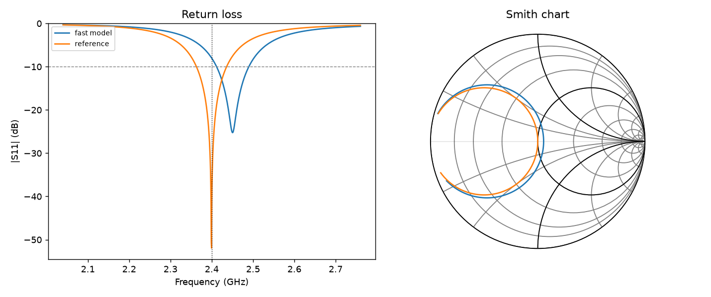

# rf-agent

A small, honest experiment on one question: **what does an agent need to design RF hardware with a fast physics model in its loop, and what happens if it trusts that model without checking?**

It is a toy version of the pattern where a fast EM surrogate is a tool an agent calls, and a slower, trusted solver confirms the result before anyone builds hardware.



*2.4 GHz inset-fed patch on FR-4 after the closed loop. On the final geometry the fast model predicts 2.45 GHz. The reference model lands on 2.400 GHz at -42 dB.*

## What's here

| Piece | What it does |
|---|---|
| `rf_tools.py` | Physics: microstrip analysis and synthesis (Hammerstad/Wheeler), patch dimensions (Balanis TL model), L-section matching (Pozar), and two patch models (below). |
| `tools_api.py` | An agent-facing tool layer in mm/GHz that returns JSON. The MCP server and the Claude agent share it. |
| `server.py` | MCP server: `design_patch`, `simulate_fast`, `verify_reference`, `microstrip`, `match_l_network`, `analyze_touchstone` (real .sNp files via scikit-rf), `plot_design`, `call_stats`. |
| `agent.py` | Design agent. It uses Claude tool use when `ANTHROPIC_API_KEY` is set, and otherwise a scripted closed loop. Every result is graded independently by re-running the reference. |
| `evals/` | 20 design targets (0.9 to 12 GHz, six substrates). Compares trusting the fast model with verify-and-correct. |

### Two models, on purpose
- **Fast (`simulate_fast`, ~30 us)**: transmission-line model with static effective permittivity and approximate edge conductance. It has no mutual coupling between the radiating edges and no conductor loss.
- **Reference (`verify_reference`, ~1 ms, about 34x slower)**: adds Getsinger dispersion, exact edge conductance plus the mutual term (numerical integrals), and dielectric plus conductor loss, which pulls down the resonant resistance.

The gap between them stands in for the gap between a learned surrogate and a full-wave solver. **The reference is still an analytic cavity-style model, not a full-wave solve.** The next step is to swap in openEMS (FDTD) behind the same `verify_reference` interface.

## Results (`python evals/run_evals.py`)

| Arm | Pass rate (S11 < -10 dB and resonance within 0.5%) | Reference calls |
|---|---|---|
| Trust fast model (open loop) | **0 / 20** | 0 |
| Fast proposes, reference verifies, correct L and inset (closed loop) | **20 / 20** | 3.3 avg |


- Mean resonance drift between the models is **2.5%**. That sounds small, but these patches have loaded Q around 6-115 and bandwidths of a few percent, so 2% puts you off the resonance. Most open-loop designs end up around -7 dB, and high-er alumina around -2 dB.
- Drift grows with **substrate thickness, frequency and permittivity**: worst cases are -6.4% on thick FR-4 at 5.8 GHz and -4.8% on alumina at 10 GHz. Those are exactly the regions where a surrogate should flag low confidence and send the agent to the solver.
- The loop converges in 2-3 iterations because the correction is physical (resonance scales roughly with 1/(L + 2dL)). It is not a blind search.

## Why this matters for agents
1. **A fast model is a proposal, not an answer.** An agent that reports the surrogate's number as done will fail quietly on hardware.
2. **The verifier must be independent.** `score()` re-runs the reference no matter what the agent claims. With Claude enabled, the eval also counts *overclaims* (the agent says verified but the grader fails it).
3. **Budget the expensive call.** The agent gets a fixed number of reference calls, which is how you would run a real solver that takes minutes to hours.

## Run it
```bash
pip install -r requirements.txt
pytest -q                                   # textbook checks (Balanis, Pozar) + MCP stdio roundtrip
python agent.py --f 2.4 --substrate FR4     # writes out/design.png + .s1p Touchstone
python evals/run_evals.py                   # add --claude to evaluate the LLM agent too
python server.py                            # MCP over stdio (see .mcp.json)
```

## Limits (on purpose)
- Single-mode TM010 rectangular patch, inset feed only. The feed notch and probe inductance are ignored.
- The reference is analytic, so absolute S11 depths like -40 dB are idealised. The relative comparison is the point.
- No ground-plane size effects, no surface waves, no manufacturing tolerance sweep. A tolerance sweep (etch +/-50 um, er +/-0.1) would be the natural next eval.

## References
Balanis, *Antenna Theory* ch. 14; Pozar, *Microwave Engineering* ch. 3 and 5; Hammerstad (1975) microstrip formulas; Getsinger (1973) dispersion model.
